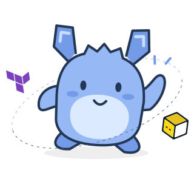
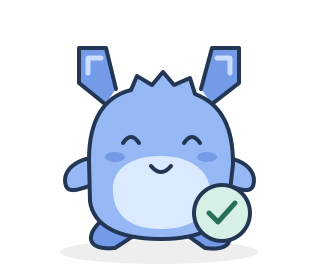
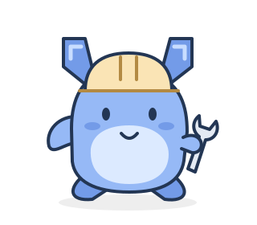

<p align="center">
  
</p>

<h1 align="center">
  
  Terrence
</h1>

<p align="center">
  <strong>Big plans. Steady hands.</strong><br/>
  A self-hosted Terraform and OpenTofu run platform.<br/>
  Manage plans, applies, state, and policies on infrastructure you control.
</p>

<p align="center">
  <a href="https://github.com/essinghigh-org/terrence/blob/master/LICENSE"></a>
  <a href="https://github.com/essinghigh-org/terrence/pkgs/container/terrence"></a>
  
</p>

<p align="center">
  <a href="#quick-start">Quick start</a> ·
  <a href="backend/docs/">Documentation</a> ·
  <a href="#development">Development</a> ·
  <a href="#meet-terrence">Meet Terrence</a>
</p>

## Features

- Workspace management with run history and locking
- Terraform and OpenTofu remote runs
- Plan review and controlled applies
- State storage and version history
- Workspace variables and variable sets
- Sentinel and OPA policy checks ([tfpolicy runtime status](backend/docs/tfpolicy-runtime.md))
- VCS integration (GitHub, GitLab, Bitbucket, Azure DevOps Services)
  - Azure DevOps Services uses organization-scoped personal access tokens (PATs), with repository discovery, source archives, authenticated service hooks, and commit/run status reporting. Workspace runs, policy sets, stacks, and private registry modules can use these connections.
  - Azure DevOps Server (`ado_server` / `azure_devops_server`) remains API-storage compatibility only. Its repository integration is unavailable.
- SSO support (SAML, OIDC, LDAP)
- Private module registry
- Run tasks and notifications
- Agent pools and cloud workload identity
- Team and role-based access control

## Azure DevOps Services

1. Create a PAT scoped to the Azure DevOps organization, with **Code (Read)** and **Code (Status)**. In Terrence, open organization **Settings → VCS integrations → Add VCS Provider**, choose **Azure DevOps Services (PAT)**, and enter the organization name, PAT, and a separate random webhook secret. Use at least 32 characters for the webhook secret and keep it in your password manager.
2. Select the saved connection in a workspace or module repository picker. VCS-backed policy sets are configured through the API. Repository identifiers use `organization/project/_git/repository`. API clients use `service-provider: ado_services`, `ado-org-name`, and `oauth-token`; only `https://dev.azure.com` or that organization's exact HTTPS base URL is accepted. PATs and webhook secrets are encrypted at rest and are never returned by the API.
3. In each Azure DevOps project's **Service hooks**, create **Web Hooks** subscriptions for **Code pushed**, **Pull request created**, and **Pull request updated**, selecting the connected repository and full resource details. Use Terrence's **Service hook setup** instructions: POST to `https://<terrence-host>/api/webhooks/azure-devops/<oauth-client-id>` with Basic authentication username `<oauth-client-id>` and password equal to the separate webhook secret, not the PAT. Terrence must be reachable over HTTPS from Azure DevOps. Subscriptions are configured manually; saving a connection does not create them.
4. Use **Rotate PAT** before expiry or after revocation. PATCHing `oauth-token` on the same OAuth client preserves token IDs and existing references when the organization is unchanged. The optional replacement webhook secret takes effect immediately; update all Azure subscriptions when replacing it. Never send either credential in a URL.

**PAT configured** means a credential was stored, not that live Azure access was verified. Repository discovery and actual runs exercise the configured access. Existing API-only clients without tokens show **Not connected** and can be configured with **Add PAT**. Azure DevOps OAuth redirects, Entra ID token refresh, legacy `visualstudio.com` endpoints, Azure DevOps Server, and automatic service-hook provisioning are not supported. Azure permissions and PAT expiry remain the operator's responsibility.

Azure workspace and VCS policy-set `ingress-submodules` supports gitlink-pinned submodules hosted in the **same Azure DevOps organization**. `.gitmodules` URLs may be canonical `https://dev.azure.com/organization/project/_git/repository` or relative URLs. The PAT must have read access to every referenced repository. Branch/update settings never override immutable gitlink commits, and custom commands are never executed. Cross-organization/external/SSH URLs, links and special files, ambiguous or unsupported Git config syntax, cycles, and incomplete API responses fail the ingestion rather than silently omit source. Limits include eight nested submodule levels, 64 tree levels, 10,000 tree members, a ten-minute deadline, and cumulative transfer/expanded-file budgets. Large repositories use more REST requests when this option is enabled. Because Azure commit diffs only show the gitlink path, recursive workspace and policy-set sources conservatively process every matching-branch push instead of skipping changes using file patterns. Stacks and registry modules also offer an optional `vcs-repo.ingress-submodules` setting (default `false`) through Terrence’s API and UI. These two flags are Terrence extensions, not fields currently exposed by the upstream `tfe_stack` or `tfe_registry_module` resources. Registry changes affect future publications only; already-published archives remain immutable.

## Quick start

### Docker

```bash
mkdir -p ./storage && sudo chown 65532:65532 ./storage

docker run -d --name terrence -p 3000:3000 \
  -e ADMIN_PASSWORD="pick-a-long-password" \
  -v ./storage:/app/backend/storage \
  ghcr.io/essinghigh-org/terrence:latest
```

For dogfooding the current `master` build, use the rolling nightly image instead:

```bash
docker pull ghcr.io/essinghigh-org/terrence:nightly
docker run -d --name terrence -p 3000:3000 \
  -e ADMIN_PASSWORD="pick-a-long-password" \
  -v ./storage:/app/backend/storage \
  ghcr.io/essinghigh-org/terrence:nightly
```

The `:nightly` tag is rebuilt after every successful commit to `master`. It is
intended for testing current changes and can change independently of versioned
releases.

Open `http://localhost:3000` and sign in as `admin` using the password you configured.

That is plain HTTP for local use. For `terraform login` and anything beyond localhost, terminate TLS first: [Reverse proxy (HTTPS)](backend/docs/reverse-proxy.md).

### Docker Compose

```bash
git clone https://github.com/essinghigh-org/terrence.git
cd terrence
ADMIN_PASSWORD="pick-a-long-password" docker compose up -d
```

## Development

Requirements:

- Bun (use the exact version pinned in `package.json` under `packageManager`)
- Terraform >= 1.9 or OpenTofu >= 1.7

```bash
bun install
(cd frontend && bun run build)
(cd backend && bun run index.ts)
```

## Documentation

Full documentation is available in [`backend/docs/`](backend/docs/) or inside a running Terrence instance under the Documentation section.

## Compatibility

Terrence supports the official `hashicorp/tfe` Terraform provider and the Terraform/OpenTofu remote workflows it implements. The provider surface is tracked against an explicit released provider version and continuously exercised by end-to-end tests.

General Terraform Enterprise or HCP Terraform API and feature parity is not a goal. An endpoint documented by TFE is not automatically part of Terrence.

## Meet Terrence

Our infrastructure companion has bracket-shaped ears, a blue coat, and a few tools for the job. You'll meet Terrence on the sign-in page, in introductory guides, and when a workspace needs a next step.

<p align="center">
  
  
  
</p>

The [SVG poses](frontend/public/brand/) share one character and palette. The [brand guide](frontend/src/components/brand/README.md) covers illustration placement, typography, spacing, and regenerating the assets. If you're contributing to the UI, reuse the shared character and controls to keep Terrence consistent.

## License

MIT — see [LICENSE](LICENSE).
